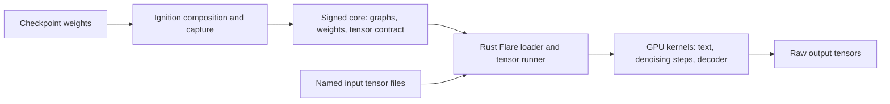

# Prepared diffusion execution

Flare executes complete diffusion pipelines through prepared CUDA graphs. Ignition
uses Python and PyTorch to load checkpoint weights, compose the model, compile its
GPU operations and capture the graphs. A separate Rust `flare run` process loads
the signed core and launches those graphs. The GPU performs text encoding,
denoising, guidance, scheduler updates and image decoding on every native replay.
The core contains executable computation and weights. Saved reference tensors
serve only as comparison artifacts.



The tensor command executes one fixed request on one GPU. Both models use the
same executor. Model equations and graph composition belong to preparation;
native code owns resources, copies bytes and launches the declared graphs.
Shapes and step counts are fixed in each core. This interface has no HTTP image
endpoint, concurrent request scheduling, cancellation, continuation or native
prompt tokenizer.

## From checkpoint to executable core

The [SDXL recipe](../ignition/recipes/sdxl/prepare.py) and
[PixArt recipe](../ignition/recipes/pixart/prepare.py) load pinned Diffusers
checkpoints and construct complete forwards with explicit input and output
storage. Tokenization, caption cleaning and schedule construction precede capture.
Text encoders execute on the GPU; state consumed by later graphs uses persistent
storage.

For a profile with `N` denoising steps, both recipes export this order:

```text
text → init → step_0 → … → step_(N-1) → decode
```

Each step has a distinct graph with its prepared timestep and coefficients. Its
model prediction and latent update execute on the GPU; Rust does not interpret a
scheduler or choose the next timestep. Changing `N` requires preparing another
core.

The shared [capture path](../ignition/preparation/capture.py) compiles and warms
complete forwards before capture. Shared
[storage lowering](../ignition/preparation/compilation.py) preserves required
native arithmetic boundaries, including matrix products, convolutions and
normalization. [Tensor metadata patches](../ignition/runtime_patches/tensor_layout.py)
preserve scalar-operation and backed-view geometry during tracing. Rounding and
layout affect subsequent kernels, so matching individual mathematical formulas
alone is insufficient to preserve the canonical computation.

[RuntimeCore export](../ignition/preparation/runtime_core.py) records allocations,
initializers, compiled modules and graph resources. Preparation supplies tensor
addresses and geometry; [native binding](../heliopause/src/export/binding.rs)
resolves them against the final split allocations. Bound inputs and outputs
become reachability roots, so pruning retains their storage. Published tensor
bindings use allocation-relative references. Core signing authenticates graph
resources and the typed tensor contract together.

## Computation in each profile

One image uses two conditioning rows for classifier-free guidance: negative
first, positive second. The denoiser evaluates both and combines their predictions
using the request's guidance tensor.

### SDXL Base 1.0

The qualified SDXL profiles generate one 1024 × 1024 image with 4 or 30 Euler
steps and guidance 5. Inputs are two token-ID tensors of shape `[2,77]`, FP16
noise `[1,4,128,128]`, FP32 guidance `[1]`, and FP16 size/crop conditioning
`[2,6]`. Size/crop rows specify original size, crop origin and target size.

| Graph | Captured computation and persistent result |
|---|---|
| `text` | Both CLIP encoders run on positive and negative tokens. Their penultimate hidden states are concatenated into `[2,77,2048]`; CLIP-2 also produces pooled conditioning `[2,1280]`. |
| `init` | Scale request noise by the scheduler's initial sigma, producing the initialized latent. |
| `step_i` | Duplicate and scale the latent for the U-Net, run the complete U-Net with text and size conditioning, apply guidance, then perform the Euler update using the prepared sigma and delta. Save `latent_after_step_i`. |
| `decode` | Cast the final latent to the VAE dtype, divide by its configured scaling factor and run the complete VAE decoder. Save raw FP32 `[1,3,1024,1024]`. |

Text encoders and U-Net use FP16 weights. Euler updates retain the canonical
FP32 sample arithmetic and cast the result back to FP16. The VAE uses the
required FP32 upcast. There are `N + 4` observable outputs: sequence and pooled
conditioning, initialized latent, every updated latent and decoded image.
Four steps provide a short correctness profile, not an image-quality preset.

### PixArt-Alpha XL 512

The qualified PixArt profile generates one 512 × 512 image with 20 steps and
guidance 4.5. Inputs are token IDs and attention masks of shape `[2,120]`, FP16
noise `[1,4,64,64]` and FP32 guidance `[1]`. Caption cleaning and resolution
binning follow the canonical Diffusers pipeline.

| Graph | Captured computation and persistent result |
|---|---|
| `text` | Run T5 for each conditioning row, retaining its FP16/FP32 parameter mix. Save FP16 conditioning `[2,120,4096]`. |
| `init` | Scale request noise into the initialized latent. |
| `step_i` | Run the complete diffusion transformer with text and masks. Apply guidance to its eight-channel prediction, retain the four noise channels, then perform the prepared DPM-Solver++ update. Save the converted prediction and updated latent. |
| `decode` | Divide the final latent by the VAE scaling factor and run the complete FP16 VAE decoder. Save raw `[1,3,512,512]`. |

The [prepared solver](../ignition/recipes/pixart/scheduler.py) uses epsilon
prediction and second-order midpoint DPM-Solver++, with first-order initial and
final updates. It preserves canonical expression grouping and dtype changes.
Each second-order update reads the previous converted prediction from persistent
storage; that history is part of the captured computation. The 43 outputs include
conditioning, initialization, all 20 latents, all 20 converted predictions and
the decoded image.

Both models use one native executor. Other models require their own preparation
composition, export and qualification.

## Signed contract and request admission

The [typed tensor contract](../helios/proto/runtime_core.proto) is carried in the
signed rank metadata defined by the [core schema](../helios/proto/core.proto).
It declares an ordered graph list and named input/output bindings. Each binding
contains an allocation reference, byte offset, dtype and shape. Byte extent is
derived from dtype and shape; the request cannot supply a replacement extent.

[Contract validation](../helios/src/runtime_core/tensor_contract.rs) checks the
version, graph existence, unique names, checked extents, alignment, allocation
bounds and disjoint input spans. Tensor execution requires fixed allocations and
one independent rank, with no token-execution contract. Request bindings must
refer to device storage; fixed host scratch may still belong to graph resources.

The remaining JSON is a file list, for example:

```json
{"inputs": [{"name": "initial_noise", "file": "initial_noise.bin"}]}
```

A request supplies every signed input exactly once; this example shows one entry.
Relative paths resolve from the request directory; entry order is irrelevant.
The [CLI](../flare-cli/src/tensors.rs) obtains the authenticated contract before
reading tensor files, checks their exact byte lengths, and rejects unknown
fields or names before loading CUDA resources. Graph order, output bindings,
dtypes and shapes cannot be overridden through JSON.

Admission validates structure, not numerical value domains such as token-ID
ranges or acceptable guidance values. The caller must supply values valid for
the prepared computation. Existing token cores retain their loading behavior.
The tensor command requires the signed tensor contract; graph-only diffusion
artifacts must be re-exported and have no unsigned request fallback.

## Native execution and storage lifetime

[NativeResources](../helios/src/runtime_core/mod.rs) owns the CUDA context,
allocations, modules, graph instances and authenticated contract.
[TensorRunner](../helios/src/runtime_core/tensors.rs) derives its graph handles
and tensor views only from that owner. It uploads every request input before each
replay, completes those transfers, then launches all graphs in order on one
stream. There is no host synchronization between graphs. Completion is confirmed
before downloading outputs, and resources remain owned until queued work drains.

Each replay starts from the uploaded noise and conditioning inputs. `text` and
`init` overwrite their results; subsequent graphs write each step's persistent
latent and, for PixArt, solver prediction. Distinct buffers preserve
intermediate outputs until download. Each replay writes this state before any
graph reads it; the runner cannot resume a partial sequence.
No compilation, recapture or GPU allocation is required during replay.

The CLI saves one correctness result and the final repeated result, rather than
every timed iteration.
Raw decoder tensors precede clipping, image rescaling and PNG encoding.

## Independent comparison and qualification

Preparation calls the canonical Diffusers pipeline with matching checkpoint,
tokens, noise and settings, observing conditioning, initialization, updates and
decoding. It separately runs the composed eager forwards and requires exact
agreement before capture. Compiled graphs then produce captured outputs in the
preparation process. Finally, a separate native process loads the exported core
and computes the same outputs from the request inputs.

The [comparison tool](../qualify/sdxl_compare.py) checks canonical, captured and
native results, including saved repeats. Canonical error bounds default to zero;
native/captured comparison also requires equal bytes. Qualification uses raw
tensors before image conversion.

On NVIDIA RTX 6000D (SM120), PyTorch 2.14.1+cu132 and Diffusers 0.43.0, two
prompts with seeds 42 and 43 produced byte-identical results across all three
paths and saved repeats. Image MAE is `mean(abs(native - canonical))`; maximum
absolute error is `max(abs(native - canonical))` over raw decoder values.

| Profile | Graphs | Outputs per prompt | Image MAE, seeds 42 / 43 | Image maximum absolute error, seeds 42 / 43 |
|---|---:|---:|---:|---:|
| SDXL, 4 steps | 7 | 8 | 0 / 0 | 0 / 0 |
| SDXL, 30 steps | 33 | 34 | 0 / 0 | 0 / 0 |
| PixArt, 20 steps | 23 | 43 | 0 / 0 | 0 / 0 |

This covers 170 named output tensors across the six cases. SDXL-4 and PixArt raw
outputs were also independently rechecked locally. SDXL-30 comparisons completed
on the cluster; its raw tensors were not retrieved for a second local check.
The Linux native processes loaded neither Python nor PyTorch. These results
qualify the stated profiles and inputs, not other checkpoints, shapes or schedules.

Replay timing starts with inputs resident on the GPU and ends with the raw decoded
tensor. Loading, tokenization, transfers and image encoding are excluded. The eager
SDXL path converts VAE precision per inference, while the prepared core retains
converted weights. Performance remains unqualified; these timings do not isolate
launch overhead or establish concurrent service performance.

## Prepare and compare fixed profiles

Use the [preparation environment](model-preparation.md#environment-setup),
including the CUDA toolkit, CUPTI, and a built Heliopause extension and Flare
CLI. The complete profiles above are qualified for native replay on one SM120
GPU. Their preparation was exercised with 96 GiB of host memory and two compiler
workers. Keep checkpoint downloads, compilation caches, and exported cores
outside the checkout, with enough disk space for several copies of the weights.

Diffusion recipes require supplemental packages beyond the `prepare` extra.
Install the tested versions while constraining already installed preparation
dependencies, then invoke the environment's Python directly. A subsequent
`uv sync` can remove these supplemental packages.

```sh
diffusion_work=$(mktemp -d)
uv pip freeze --python .venv/bin/python --exclude-editable > "$diffusion_work/constraints.txt"
uv pip install --python .venv/bin/python --constraint "$diffusion_work/constraints.txt" \
  'diffusers==0.43.0' 'beautifulsoup4==4.14.3' 'ftfy==6.3.1' \
  'sentencepiece==0.2.1' 'soupsieve==4.1.1' 'wcwidth==0.9.4'
uv pip check --python .venv/bin/python

sdxl_snapshot=$(.venv/bin/hf download stabilityai/stable-diffusion-xl-base-1.0 \
  --revision 462165984030d82259a11f4367a4eed129e94a7b \
  --include '*.json' '*.txt' '*.fp16.safetensors')
pixart_snapshot=$(.venv/bin/hf download PixArt-alpha/PixArt-XL-2-512x512 \
  --revision 50f702106901db6d0f8b67eb88e814c56ded2692 \
  --include '*.json' '*.txt' '*.model' '*.safetensors')

.venv/bin/python -m ignition.recipes.sdxl.prepare --snapshot "$sdxl_snapshot" \
  --output "$diffusion_work/sdxl-30" --steps 30 --compile-workers 2
.venv/bin/python -m ignition.recipes.pixart.prepare --snapshot "$pixart_snapshot" \
  --output "$diffusion_work/pixart-20" --steps 20 --compile-workers 2
```

Each command runs the two canonical references, enforces exact eager composition,
captures compiled outputs, and publishes a core with both request files. For
the four-step SDXL profile, use `--steps 4` and a separate output directory.
The recipes generate a development publisher; the following native commands
accept the fingerprint recorded by that local preparation. Existing output
directories are rejected, so use fresh native destinations when repeating runs.

```sh
: > "$diffusion_work/flare.toml"
comparison_status=0
for prepared in "$diffusion_work/sdxl-30" "$diffusion_work/pixart-20"; do
  fingerprint=$(.venv/bin/python -c \
    'import json,sys; print(json.load(open(sys.argv[1]))["fingerprint"])' \
    "$prepared/publisher-info.json")
  for case in case_a case_b; do
    flare-cli/target/release/flare --config "$diffusion_work/flare.toml" \
      run "$prepared/core" --gpus 0 --offline --verify-weights \
      --publisher-keys "$prepared/publisher.json" \
      --trust-store "$diffusion_work/trust.json" \
      --dangerously-approve-key "$fingerprint" \
      --dangerously-accept-publisher local-development \
      --tensor-request "$prepared/$case/request.json" \
      --tensor-output "$prepared/$case/native" \
      --tensor-warmup 3 --tensor-repetitions 5 || exit $?
    .venv/bin/python -m qualify.sdxl_compare \
      --reference "$prepared/$case/reference.json" \
      --captured "$prepared/$case/captured.json" \
      --native "$prepared/$case/native/report.json" \
      --output "$prepared/$case/comparison.json" --images || comparison_status=1
  done
done
test "$comparison_status" -eq 0
```

The comparison writes per-tensor errors, repeatability, raw timing samples,
and `pytorch.png` and `flare.png`. Native/captured acceptance requires identical
bytes as well as finite values, including identical signed zeros. Canonical
acceptance uses the explicitly recorded numerical bounds, which default to
zero. A failed canonical comparison returns nonzero and withholds timing
ratios even when native replay is byte-identical to the captured graphs.
